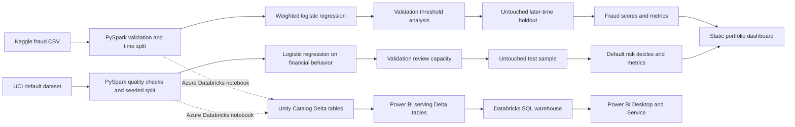

# Card Risk Analytics with PySpark

A portfolio project for practicing two separate payment-risk analytics problems:

1. **Transaction fraud triage** — rank card transactions for investigation while measuring fraud capture and false-alert workload.
2. **Credit default monitoring** — rank accounts for a hypothetical review queue and measure how default rates change across risk groups.

This is an independent public-data project. It does not use American Express internal data, reproduce Amex policy, or claim that either public benchmark represents Amex customers.

## Interactive website dashboard

**Live site:** [Open the dashboard](https://malhar02.github.io/card-risk-analytics/) — hosted on GitHub Pages.

The static dashboard in the site/ folder includes an executive overview, a fraud validation-threshold explorer, a credit risk-decile and repayment-status explorer, and a methodology page. Charts, filters, table sorting, search, and aggregate CSV/JSON exports run in the browser without a backend service.

The website loads only the compact aggregate snapshot in site/data/dashboard.json. It does not include the raw transaction file or account-level credit records. Rebuild that snapshot from the six prepared aggregate CSVs with:

    & ".\.venv\Scripts\python.exe" ".\scripts\build_dashboard_data.py"

For a local browser preview from the project root:

    & ".\.venv\Scripts\python.exe" -m http.server 8765 --directory ".\site"

GitHub Pages deployment is configured in .github/workflows/pages.yml.

## Business questions

- At a chosen fraud-review threshold, how many fraud transactions are surfaced, how many legitimate transactions are also reviewed, and how much fraud is missed?
- Does account default risk concentrate in the highest-scored groups?
- What share of accounts and observed defaults would be routed to a manual review queue with limited capacity?
- How should analysts explain the limits of short historical benchmarks and uncalibrated model scores?

Fraud detection and credit-default review are intentionally modeled as different tasks, with different data, split strategies, and operating metrics.

## Data and provenance

### Transaction fraud

The local file `data/creditcard.csv` comes from the [ULB Credit Card Fraud Detection dataset on Kaggle](https://www.kaggle.com/datasets/mlg-ulb/creditcardfraud). It contains anonymized PCA features (`V1`–`V28`), elapsed transaction time, amount, and a binary fraud label. The labels are highly imbalanced; accuracy is therefore not used as the main model metric.

### Credit default

`src/08_download_credit_default.py` downloads and normalizes the [UCI Default of Credit Card Clients dataset](https://archive.ics.uci.edu/dataset/350/default+of+credit+card+clients) (UCI ID 350; DOI [10.24432/C55S3H](https://doi.org/10.24432/C55S3H)). UCI describes 30,000 accounts from a historical Taiwan bank study and licenses the dataset under CC BY 4.0. The data is not Amex or U.S. lending data. The script records dataset provenance under `data/raw/uci_credit_default_source.json`.

The default model uses credit limit, repayment history, statement balances, and prior payment amounts. Sex, education, marital status, and age are excluded from its model features. They are not used to make model scores or review flags.

## Architecture



## Run locally on Windows

Run commands from the project root in VS Code’s PowerShell terminal. Use the project virtual environment so VS Code’s global Python does not hide PySpark.

```powershell
& ".\.venv\Scripts\python.exe" -m pip install -r ".\requirements.txt"
```

Download `creditcard.csv` from the [Kaggle fraud dataset](https://www.kaggle.com/datasets/mlg-ulb/creditcardfraud), then place it at `data\creditcard.csv`. The source CSV is intentionally excluded from Git; the repository includes the aggregate dashboard snapshot and its six aggregate input tables.

```powershell
& ".\.venv\Scripts\python.exe" ".\src\07_select_threshold.py"
```

The script trains the fraud baseline, compares validation thresholds, scores the later-time holdout, and writes local CSV/JSON outputs without Spark’s Windows Hadoop CSV writer.

Download and analyze the separate UCI credit-default dataset:

```powershell
& ".\.venv\Scripts\python.exe" ".\src\08_download_credit_default.py"
& ".\.venv\Scripts\python.exe" ".\src\09_analyze_credit_default.py"
```

Build the static dashboard after both model tracks have outputs:

```powershell
& ".\.venv\Scripts\python.exe" ".\src\10_build_dashboard.py"
```

Open `reports\risk_analytics_dashboard.html` in a browser. It is self-contained and embeds only aggregate charts and model metrics, not row-level account records. The interview-ready [decision memo](reports/decision_memo.md) summarizes the results and limitations.

### Useful exploratory scripts

The earlier numbered scripts remain available for individual stages:

- `01_fraud_spark_demo.py` — synthetic Spark smoke demo.
- `02_load_fraud_data.py` — inspect fraud schema and row counts.
- `03_profile_fraud_data.py` — basic fraud data-quality profile.
- `04_fraud_monitoring_metrics.py` — descriptive monitoring metrics.
- `05_prepare_time_split.py` — demonstrate the chronological split.
- `06_train_fraud_baseline.py` — initial 70/30 weighted logistic baseline.
- `07_select_threshold.py` — final fraud pipeline and holdout exports.

## Project outputs

Generated local files are written under `data/processed/` and ignored by Git:

- `fraud_holdout_scores.csv` — holdout elapsed time, amount, actual fraud label, model score, and alert flag.
- `fraud_validation_thresholds.csv` — validation alert counts, precision, and recall by threshold.
- `fraud_model_metrics.json` — fraud holdout metrics and selected threshold.
- `credit_default_test_scores.csv` — test-set risk score, review flag, decile, and limited explanatory fields.
- `credit_default_validation_policy.csv` — validation workload and default-capture trade-offs.
- `credit_default_deciles.csv` — observed test default rate and average score per risk decile.
- `credit_default_delinquency_segments.csv` — test outcomes by most recent payment-status category.
- `credit_default_metrics.json` — credit model metrics and the validation-selected review capacity.

The final dashboard is written to `reports/risk_analytics_dashboard.html`.

## Power BI handoff

Build or refresh the local Power BI import kit after both model tracks have generated outputs:

```powershell
& ".\.venv\Scripts\python.exe" ".\src\11_prepare_powerbi_package.py"
```

This creates `reports/powerbi_dashboard_kit.zip` and six import-ready CSV tables under `reports/powerbi_import/`. The CSVs are local snapshots for Power BI Desktop; for the cloud-connected version, run the Azure Databricks notebook and connect to its Unity Catalog Delta serving tables. Follow [POWER_BI_AZURE_GUIDE.md](reports/POWER_BI_AZURE_GUIDE.md) for the connector, data model, DAX, and report pages. Power BI Desktop must be signed in to save and publish a `.pbix` report.

## Results and interpretation

In the fraud run shared during development, a 0.80 validation-selected score threshold produced the following later-time holdout result:

| Metric | Result |
|---|---:|
| Holdout PR AUC | 0.5318 |
| Fraud transactions flagged | 89 of 108 |
| Legitimate transactions also flagged | 224 |
| Alerts sent to review | 313 |
| Precision | 28.4% |
| Recall | 82.4% |

This illustrates a review-capacity trade-off: the model surfaced most labeled fraud in this holdout, while also creating many false alerts. It does not establish production performance. The score is a ranking signal from a class-weighted logistic model, not a calibrated fraud probability.

The credit-default script selects the score cutoff using the validation set’s top-20% risk-score quantile, then reports its results on a separate test split. In the completed run, the test PR AUC was 0.5062 and ROC AUC 0.7116. A 20.6% test review queue contained 506 of 1,004 defaults (50.4% capture), with 412 non-default accounts also reviewed. The highest risk decile had a 70.0% observed default rate, versus 22.5% across the test set. The queue represents a hypothetical review scenario, not a credit approval or decline policy. Its risk score is not calibrated as a real-world probability of loss.

## Azure Databricks path

`notebooks/azure_databricks_pipeline.py` is a parameterized notebook source for Azure Databricks. It reads both CSVs from a Unity Catalog Volume, validates labels and columns, curates Delta tables, trains Spark ML baselines, and writes scored Delta tables to a Unity Catalog schema.

The notebook expects:

- `raw_volume_root` such as `/Volumes/<catalog>/<schema>/<volume>/raw`, containing `fraud/creditcard.csv` and `credit_default/uci_credit_default.csv`.
- `target_catalog_schema` such as `main.risk`.
- Unity Catalog permissions to read the Volume and create/write managed tables in the target schema.

After running the pipeline, the notebook creates a Power BI serving layer in the target schema: `risk_dashboard_domain`, `risk_dashboard_summary`, `fraud_dashboard_thresholds`, `fraud_dashboard_hourly`, `credit_dashboard_deciles`, and `credit_dashboard_payment_status`. Connect Power BI Desktop to these tables through an Azure Databricks SQL warehouse. See the full [Azure-connected Power BI setup guide](reports/POWER_BI_AZURE_GUIDE.md) and the report [theme file](reports/powerbi_theme.json).

No storage keys or secrets are embedded. Azure resources are not provisioned by this repository; a workspace, compute, Unity Catalog Volume, and permissions must exist before running the notebook. See Microsoft’s [Azure Databricks concepts](https://learn.microsoft.com/en-us/azure/databricks/getting-started/concepts) and [Unity Catalog volumes](https://learn.microsoft.com/en-us/azure/databricks/volumes/).

## Limits and responsible use

- Public benchmark results do not show how an operational Amex model would perform.
- The fraud dataset has anonymized features and a short historical time span; it lacks customer, merchant, device, and richer behavioral context.
- The UCI dataset is an older, cross-sectional Taiwan bank dataset; it cannot support temporal generalization tests and does not represent current U.S. lending.
- Thresholds are operating scenarios. A real system would require calibrated probabilities, approved cost assumptions, fairness and legal review, drift monitoring, human oversight, and validation on representative current data.
- These models are portfolio demonstrations, not credit or fraud decisions for real people.

## References

- Yeh, I. (2009). [Default of Credit Card Clients](https://doi.org/10.24432/C55S3H). UCI Machine Learning Repository.
- [ULB Credit Card Fraud Detection dataset](https://www.kaggle.com/datasets/mlg-ulb/creditcardfraud).
- [Apache Spark ML classification guide](https://spark.apache.org/docs/latest/ml-classification-regression.html).
- [Azure Databricks concepts](https://learn.microsoft.com/en-us/azure/databricks/getting-started/concepts).
