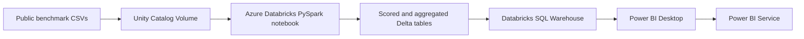

# Azure-Connected Power BI Dashboard

This guide connects the project to Azure Databricks and builds a two-page Power BI report from the dashboard-serving Delta tables. The report keeps fraud triage and credit-default review as separate analyses because they use different public datasets, split strategies, and operating measures.

## Cloud architecture



The notebook already includes the dashboard-serving layer. Run `notebooks/azure_databricks_pipeline.py` in an Azure Databricks workspace with Unity Catalog, then connect Power BI Desktop to a Databricks SQL warehouse. Microsoft documents the **Azure Databricks** connector for both **Import** and **DirectQuery**; a SQL warehouse is required, and it is recommended for DirectQuery. See [Connect Power BI Desktop to Azure Databricks](https://learn.microsoft.com/en-us/azure/databricks/partners/bi/power-bi/desktop) and the [Azure Databricks Power Query connector reference](https://learn.microsoft.com/en-us/power-query/connectors/databricks-azure).

## 1. Prepare the Azure Databricks workspace

You need an Azure subscription, an Azure Databricks workspace with Unity Catalog enabled, permission to upload files and run a notebook, and a Databricks SQL warehouse. Azure resource creation and compute usage can incur charges; stop the SQL warehouse and notebook compute when you finish.

In Catalog Explorer, create (or choose) a catalog, schema, and Unity Catalog volume. The example names below are used throughout this guide:

| Object | Example |
|---|---|
| Catalog | `risk_demo` |
| Schema | `risk` |
| Raw data volume | `risk_raw` |
| Notebook target | `risk_demo.risk` |
| Raw volume root parameter | `/Volumes/risk_demo/risk/risk_raw/raw` |

Create two subfolders in the volume and upload the existing project CSVs into them:

```text
/Volumes/risk_demo/risk/risk_raw/raw/fraud/creditcard.csv
/Volumes/risk_demo/risk/risk_raw/raw/credit_default/uci_credit_default.csv
```

Use the Kaggle ULB fraud CSV already in the project and the normalized UCI file produced by `src/08_download_credit_default.py`. These are public benchmark datasets, not Amex data. The notebook deliberately excludes demographic fields from the credit-default model features.

If your catalog or schema names differ, use your own names in the widget values and paths. `target_catalog_schema` is a two-part `catalog.schema` value.

## 2. Run the Azure Databricks notebook

1. Import `notebooks/azure_databricks_pipeline.py` into your Databricks workspace as a Python notebook.
2. Attach a supported notebook compute resource with Unity Catalog access.
3. Set the notebook widgets:

   - `raw_volume_root`: `/Volumes/risk_demo/risk/risk_raw/raw`
   - `target_catalog_schema`: `risk_demo.risk`

4. Run all cells. The notebook validates both datasets, trains the two baseline models, writes scored Delta tables, and creates the Power BI serving tables below.
5. In Catalog Explorer, confirm the tables are present in the `risk_demo.risk` schema and that your Power BI identity has permission to use the SQL warehouse and read these tables.

### Tables to select in Power BI

| Table | Use in the report |
|---|---|
| `risk_dashboard_domain` | Small domain dimension and dataset-context notes |
| `risk_dashboard_summary` | KPI cards for both test samples and their review policies |
| `fraud_dashboard_thresholds` | Validation threshold, alert workload, precision, and recall |
| `fraud_dashboard_hourly` | Fraud counts and alert activity by elapsed dataset hour |
| `credit_dashboard_deciles` | Test-set default rate and review counts by risk decile |
| `credit_dashboard_payment_status` | Test-set outcomes by the benchmark's latest payment-status code |

The scored row-level tables are available for drill-through if wanted, but the report can be built from the six smaller serving tables above. The table names are `<catalog>.<schema>.<table>`; with the example names, use `risk_demo.risk.risk_dashboard_summary`.

## 3. Connect Power BI Desktop

1. Open Power BI Desktop and choose **Get data**.
2. Search for and choose **Azure Databricks** (the Azure connector). Do not choose a different connector unless your workspace administrator tells you to.
3. In the Databricks SQL warehouse page, copy its **Server hostname** and **HTTP path** into the connector fields. Find both under the warehouse's connection details. Set the default catalog to `risk_demo` and database/schema to `risk` if those optional fields are shown.
4. Choose **Import** for the first portfolio report. This loads a snapshot into the Power BI semantic model and is straightforward for these modest benchmark outputs. Choose **DirectQuery** only if you specifically want each visual to query Databricks live; that mode depends on an available SQL warehouse and may feel slower while the warehouse starts or computes.
5. Sign in with an authentication method enabled for your workspace. For an individual interactive build, use your Microsoft Entra ID sign-in if offered. Do not paste a token or client secret into a report, notebook, or Git repository.
6. In Navigator, select the six serving tables from `risk_demo.risk`, then choose **Load**.

The current Power BI connector documents Import and DirectQuery support. The Azure Databricks desktop integration guide also describes the server hostname/HTTP path, available authentication methods, and SQL warehouse requirement. Review the current [connector documentation](https://learn.microsoft.com/en-us/power-query/connectors/databricks-azure) if your organization has different authentication or network rules.

## 4. Set up the semantic model

In Model view, create these one-to-many relationships, with single-direction filtering from `risk_dashboard_domain` to each fact table:

```text
risk_dashboard_domain[risk_domain]  1 -> *  risk_dashboard_summary[risk_domain]
risk_dashboard_domain[risk_domain]  1 -> *  fraud_dashboard_thresholds[risk_domain]
risk_dashboard_domain[risk_domain]  1 -> *  fraud_dashboard_hourly[risk_domain]
risk_dashboard_domain[risk_domain]  1 -> *  credit_dashboard_deciles[risk_domain]
risk_dashboard_domain[risk_domain]  1 -> *  credit_dashboard_payment_status[risk_domain]
```

Use the `risk_dashboard_domain[dataset_context]` field in a small note or tooltip. Set `credit_dashboard_deciles[risk_decile]` to sort ascending; **decile 1 is the highest model score**. The fraud time is elapsed benchmark time, not a calendar timestamp.

Create these measures in `risk_dashboard_summary`:

```DAX
Records = SUM(risk_dashboard_summary[records])
Observed Events = SUM(risk_dashboard_summary[observed_events])
Review Alerts = SUM(risk_dashboard_summary[review_alerts])
True Positives = SUM(risk_dashboard_summary[true_positives])
False Positives = SUM(risk_dashboard_summary[false_positives])
Missed Events = SUM(risk_dashboard_summary[false_negatives])
Precision = DIVIDE([True Positives], [Review Alerts])
Recall = DIVIDE([True Positives], [True Positives] + [Missed Events])
Observed Event Rate = DIVIDE([Observed Events], [Records])
Review Rate = DIVIDE([Review Alerts], [Records])
PR AUC = MAX(risk_dashboard_summary[pr_auc])
ROC AUC = MAX(risk_dashboard_summary[roc_auc])
Decision Cutoff = MAX(risk_dashboard_summary[decision_cutoff])
```

Format `Precision`, `Recall`, `Observed Event Rate`, and `Review Rate` as percentages. Use `PR AUC`, not accuracy, as the primary ranking metric for these imbalanced fraud labels. The Power BI measures recompute threshold operating precision/recall from the stored confusion-count fields.

## 5. Build the report pages

Apply the included `reports/powerbi_theme.json` from **View → Themes → Browse for themes**. Use the separate report pages below rather than combining the two unrelated target populations into one chart.

### Page 1 — Fraud triage

Set a page filter on `risk_dashboard_domain[risk_domain]` to **Fraud**.

- KPI cards: **Records**, **Observed Events**, **Review Alerts**, **Precision**, **Recall**, and **PR AUC**.
- Line chart: `fraud_dashboard_thresholds[threshold]` on the x-axis; `precision` and `recall` as lines. Add `alerts` in a separate chart or tooltip to show the analyst workload trade-off.
- Trend chart: `fraud_dashboard_hourly[elapsed_dataset_hour]` on the x-axis; `fraud_count` and `alert_count` as values. Label the axis as elapsed benchmark time, not a date.
- Table: threshold, alerts, true positives, false positives, false negatives, precision, recall. Sort threshold ascending.
- Add a note: “Fraud score is uncalibrated. Public anonymized benchmark; results do not represent Amex production performance.”

### Page 2 — Credit default review

Set a page filter on `risk_dashboard_domain[risk_domain]` to **Credit Default**.

- KPI cards: **Records**, **Observed Events**, **Review Alerts**, **Precision**, **Recall**, **PR AUC**, and **ROC AUC**.
- Column chart: `credit_dashboard_deciles[risk_decile]` on the x-axis and `observed_default_rate` as the value; sort decile ascending and format as a percentage. Add `account_count` and `reviewed_account_count` to tooltips.
- Column or bar chart: `latest_payment_status_code` versus `observed_default_rate`; show `account_count` in tooltips so small segments are visible.
- Show `decision_policy` and `decision_cutoff` in a text card or tooltip. Clarify that the cutoff is a hypothetical review-capacity scenario, not a lending decision rule.
- Add a note: “Historical UCI Taiwan bank benchmark; not U.S. lending data and not representative of current Amex customers.”

### Page 3 — Definitions and limitations (optional)

Add a small measure dictionary and the dataset-context notes. State the split strategy: later-time holdout for fraud; seeded random test sample for credit default, whose source dataset has no event date. Include the cutoff policy on each page so the reported results remain interpretable.

## 6. Publish and refresh through Power BI Service

1. Save the `.pbix` locally and choose **Publish** to a workspace you can access.
2. In Power BI Service, open the semantic model's settings and configure the Azure Databricks data-source credentials using an authentication option allowed by your workspace. Never commit credentials to this project.
3. For **Import**, refresh the semantic model after rerunning the Databricks notebook. Configure a refresh schedule only if the benchmark outputs will be regenerated on a regular schedule.
4. For **DirectQuery**, visuals query the SQL warehouse; use a SQL warehouse designed for BI and ensure the report viewers have the appropriate Databricks permissions. Microsoft documents single sign-on options for DirectQuery in the [Power BI Service integration guide](https://learn.microsoft.com/en-us/azure/databricks/partners/bi/power-bi/service).
5. If your Databricks workspace or storage is behind private networking/firewalls, follow the connector's current gateway/network prerequisites. See the [Azure Databricks connector prerequisites](https://learn.microsoft.com/en-us/power-query/connectors/databricks-azure#prerequisites).

## What this project provides and what remains account-specific

The repository now prepares the Delta serving tables and gives you the cloud connection and report design steps. Creating the Azure workspace, Unity Catalog objects, SQL warehouse, Power BI account/workspace, and publishing a signed-in `.pbix` require your own Microsoft/Azure account and permissions. No secrets are stored in this project. The existing local HTML dashboard remains available at `reports/risk_analytics_dashboard.html` for a quick offline preview.
